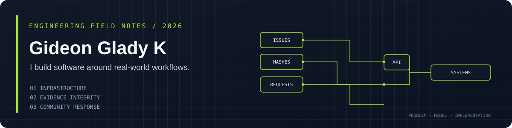

 

**Software engineering · Systems thinking · Product-minded development**

[LinkedIn](https://www.linkedin.com/in/gideonglady/) · [Repositories](https://github.com/Gideonglady?tab=repositories) · [Explore my work ↓](#selected-work)

---

## The kind of problems I like

I like building software around real workflows: tracking what needs fixing, keeping evidence verifiable, and connecting people to time-sensitive services.

I'm Gideon, a Computer Science and Business Systems student at Thiagarajar College of Engineering. My interests sit around backend development, application architecture, databases, and blockchain systems. I care about how a feature behaves beyond the happy path: who can use it, what happens when something changes, and how someone can understand or verify the result.

## Selected work

<table>
<tr>
<td width="50%" valign="top">

### 01 / Infrastructure operations

**[CSBS Infrastructure Management System](https://github.com/Gideonglady/CSBS-Infrastructure-management-system)**

A department-focused system for managing lab and classroom assets, maintenance issues, and equipment transfers.

**My contribution:** Owned the Issue Management module end to end, from data model and APIs to the React interface.

`React` `Node.js` `Express` `MongoDB`

[Open repository](https://github.com/Gideonglady/CSBS-Infrastructure-management-system) · [Live application](https://infra-stream-net.vercel.app/)

</td>
<td width="50%" valign="top">

### 02 / Evidence integrity

**[Forensic Evidence Management System](https://github.com/Gideonglady/Forensic_Evidence_Management_System)**

A mobile and backend project exploring evidence handling, cryptographic hashes, Merkle trees, and blockchain records.

**My contribution:** Wrote the Solidity smart contracts and React Native frontend; the project uses FastAPI and IPFS in its stack.

`React Native` `FastAPI` `Solidity` `IPFS`

[Open repository](https://github.com/Gideonglady/Forensic_Evidence_Management_System)

</td>
</tr>
<tr>
<td width="50%" valign="top">

### 03 / Community response

**[NSS Blood Donation App](https://github.com/Gideonglady/NSS_BD_APP)**

A blood donation coordination application with donor/recipient workflows, nearby requests, donation status tracking, and an administration interface.

**Project focus:** Connecting mobile workflows, backend APIs, location-aware requests, and notifications.

`Flutter` `Dart` `Node.js` `TypeScript`

[Open repository](https://github.com/Gideonglady/NSS_BD_APP)

</td>
<td width="50%" valign="top">

### 04 / Product engineering

**Xtendone · Consultancy project**

Worked on a deployed, client-facing spreadsheet interaction layer.

Implemented range selection, keyboard navigation, clipboard operations, fill handle, and undo/redo.

`React` `JavaScript` `Spring Boot`

*Team project; source repository is not linked here.*

</td>
</tr>
</table>

## How I approach engineering

| I pay attention to | What that means in practice |
|---|---|
| **Data and state** | Model the workflow before wiring up the UI. |
| **Failure paths** | Think about rejected actions, invalid input, missing services, and recovery. |
| **Traceability** | Keep changes understandable and make important state transitions inspectable. |
| **Maintainability** | Prefer clear boundaries between the interface, API, persistence, and business rules. |
| **Honest documentation** | Explain what works, what is incomplete, and how to run the project. |

## Technical toolkit

**Languages**  
Java · JavaScript · Python · C++ · SQL · Solidity

**Application development**  
React · React Native · Node.js · Express · Spring Boot · FastAPI

**Data and infrastructure**  
MySQL · MongoDB · IPFS · REST APIs · Git · GitHub

I use these technologies across coursework and projects; the depth of experience varies by tool.

## Outside the code editor

I also work on technical content and design. I've planned LinkedIn content using audience-response data, designed interfaces, and contributed to department and NSS communications. Those experiences have made me think about how software is explained and how people actually interact with it—not just how it is implemented.

## Currently improving

- Data structures and algorithms, with Java as my primary practice language.
- Core computer science foundations: DBMS, operating systems, and networking.
- Backend design, API boundaries, and the quality of project documentation.

## Find me

- **GitHub:** [@Gideonglady](https://github.com/Gideonglady)
- **LinkedIn:** [gideonglady](https://www.linkedin.com/in/gideonglady/)

Built around real projects, documented trade-offs, and steady improvement—not a wall of badges.
